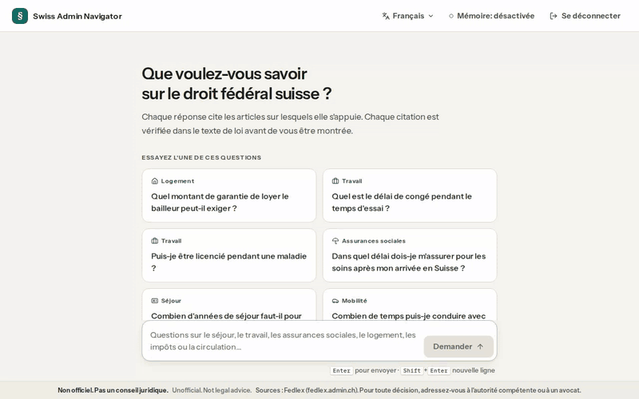
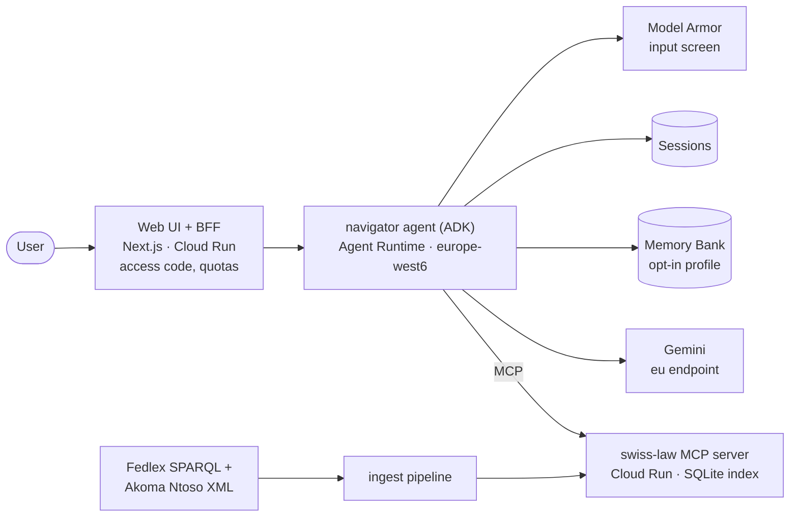

# Swiss Admin Navigator

**Ask everyday questions about Swiss federal law in English, German, French or
Italian, and get answers where every legal statement cites the exact article on
Fedlex, with a verbatim quote that code has checked against the law text.**

A citation-grounded agent over 23 federal acts (permits, citizenship, work,
social insurance, rent, tax at source, mobility), built on **Gemini Enterprise
Agent Platform**: ADK 2.12 on Agent Runtime with Sessions, opt-in Memory Bank
and a Model Armor input screen, retrieving through a public **MCP server** for
Swiss federal law. Every design choice (retrieval, single vs multi-agent,
verifier, model, memory, injection screen) was decided by evals on a 150-case
golden set, and the numbers are in this repo.

> ⚠️ **Unofficial. Not legal advice.** Not affiliated with the Swiss
> Confederation or any canton. Law texts come from
> [Fedlex](https://www.fedlex.admin.ch). For decisions, contact the competent
> authority.



*A question in French → an answer with four citations, led by CO Art. 271a,
every quote verified in the French text → the article opened beside the answer →
opt-in memory remembers "Lausanne, permit B" → Forget me. Recorded on the
deployed app on 2026-10-20; the 66 s and 57 s waits for the answers are sped
up.*

## Results

The served configuration on the golden set (150 cases, DE/EN/FR/IT, five
domains; run 2026-10-20 on the Fedlex consolidations resolved 2026-10-15):

- **0 hallucinated citations** of 549, and **99.6%** of quotes verbatim in
  the cited article
- **95.4%** of the expected key facts covered; the right behaviour (answer,
  ask, point to the canton, decline) in **97.3%** of cases
- **CHF 0.039** per answer, p50 39 s

| metric (golden 150, 95% bootstrap CIs) | value |
|---|---|
| quote fidelity (the quote is a substring of the cited article) | 99.6% (547/549) |
| hallucinated citations (the article does not exist) | 0 of 549 |
| required-citation recall | 96.5 (93.1–99.2) |
| groundedness (claims supported by the cited text), judged | 81.9 (77.9–85.4) Flash judge · 91.9 (89.7–93.8) Qwen3 judge |
| key-fact coverage, judged | 95.4 (93.1–97.6) · 94.8 (91.7–97.4) |
| behaviour (rule + judge) | 97.3 (94.7–99.3) · 96.7 (93.3–99.3) |
| answer in the user's language | 100 |
| cost / latency per answer | CHF 0.039 / p50 39 s, p95 109 s |

Agent `gemini-3.8-flash` on the `eu` endpoint, deterministic citation
verifier, Model Armor screen. The judged metrics are graded twice, by
`gemini-3.8-flash` and by Qwen3 235B (a different model family), so the agent's
own family is never the only judge (ADR-026). The golden cases
were checked against the article text by Claude Opus 5.5, not by a lawyer
(ADR-024). Report: [`evals/reports/2026-10-20-66315a7-e1-flash-eu.md`](evals/reports/2026-10-20-66315a7-e1-flash-eu.md).

### What the experiments decided

| experiment | measured | decision |
|---|---|---|
| **E4** retrieval (102 queries) | dense recall@8 **98.5%**; BM25 51%; BM25 + dense fusion 85% | dense with contextual chunk headers; BM25 only as the fallback (ADR-016) |
| **E2** multi-agent (golden + adversarial) | router + domain specialists: groundedness −1.7 to −2.8, +13% cost, although the router picks the right domain 98% of the time | single agent stays (ADR-034) |
| **E6** verifier | code check (re-fetch, substring, paragraph): fidelity 98.5% → 99.6% for +7% cost. LLM claim checker: groundedness +4.4 (CI +2.4…+6.5) for ×1.8 cost; on a healthy endpoint p50 45 → 78 s, p95 78 → 166 s | code check on; claim checker opt-in, off in the web app (ADR-034) |
| **E1** models (golden) | table below | Flash stays (ADR-035) |
| **E7** Model Armor (58 attacks, 532 benign questions, 400 law texts) | blocks 29% of attacks (9/10 direct overrides, **0/13 injections inside pasted documents**), 0 false positives | screen user input at medium; the verifier stays the main defence (ADR-032) |
| **E8** memory (26 cases) | Memory Bank defaults pass **2/13** privacy cases (stored a diagnosis, a conviction, a religion); a structured profile whose schema is the whitelist passes 39/39 | opt-in structured profile (ADR-029) |
| **E5** languages (40 questions × 4 languages) | no difference beyond noise; English answers quote the German text | — |

**E1, the same agent with different models** (golden 150; groundedness change
vs Flash on the same cases, Flash judge / Qwen judge):

| model | Δ groundedness | key facts | CHF / answer | p50 | note |
|---|---|---|---|---|---|
| **gemini-3.8-flash** (served) | — (81.9 / 91.9) | 95.4 | 0.039 | 39 s | |
| gemini-4-argon | **+7.4 / +4.8** | 97.4 | 0.049, 0.099 from 2026-12-01 | 46 s | loops in 3–10% of cases |
| gemini-3.1-pro-preview | −7.3 / −4.4 | 93.9 | 0.071 | 51 s | reads fewer articles |
| gemini-3.5-flash-lite | −1.8 / −3.7 | 82.3 | 0.005 | 5 s | misses key facts |
| DeepSeek V3.2 (MaaS) | −4.7 / −2.7 | 82.9 | 0.019 | 85 s | behaviour −18.7 |
| Qwen3 235B (MaaS) | −13.3 / −9.1 | 71.5 | 0.020 | 31 s | never asks back |
| Apertus 1.5 8B (vLLM, Cloud Run L4) | −68.0 / −58.1 | 34.3 | 0.012 GPU time | 67 s | 144/150 drafts off-schema; ≈ CHF 850/month always-on |

No arm, not even the 8B model, cites an article that does not exist: the
verifier holds that line for every model, at the cost of redrafts.

Full tables with paired CIs: [docs/RESULTS.md](docs/RESULTS.md) · methodology:
[docs/EVALS.md](docs/EVALS.md) · all reports: [`evals/reports/`](evals/reports/)

## How it works



1. The BFF checks the access code and quotas, then streams the agent's
   progress ("Reading CO Art. 271a") to the browser.
2. The agent screens the message with Model Armor. An injection gets a fixed
   refusal, and no model or tool call runs.
3. The agent searches (`search_law`), browses (`get_toc`) and reads
   (`get_article`) through the MCP server, then writes a structured answer:
   markdown with `[n]` markers and one citation object per marker (act,
   article, paragraph, letter, quote).
4. **Before the answer leaves the agent, a citation verifier in code
   re-fetches every cited article**. It substring-checks every quote, checks
   that the paragraph and letter exist and are in force, and rejects contact
   details the model may have invented. A failing draft goes back once with
   the exact problems. The verifier then sets the Fedlex deep link and the
   "as of" date itself (ADR-018).

Agent Runtime, Sessions and Memory Bank are deployed in europe-west6
(Zürich). Gemini is not served in Zürich, so the agent's model calls are
processed on the `eu` endpoint within the EU (ADR-013); memory extraction, for
users who opt in, runs on a global endpoint (ADR-029). Every model and tool call is a span in Cloud Trace.
Details: [docs/ARCHITECTURE.md](docs/ARCHITECTURE.md).

## Why it's built this way

| choice | reason |
|---|---|
| Fedlex Akoma Ntoso XML, one record per article | Laws are structured, and the article is the citation unit. Federal enactments are not subject to copyright (Art. 5 URG). The build is lock-driven: every act and its sha256 is pinned in `corpus/manifest.lock.json`. |
| The MCP server is the retrieval boundary | Any MCP client can use it, and it is tested and deployed on its own. It is public and read-only. |
| SQLite baked into the image, no vector database | 23 acts in four languages don't justify a vector database's cost floor. Cold start is 2.6 s to the first response. |
| Citations checked in code, not in the prompt | A prompt makes verbatim quotes likely; a substring check against the fetched article makes them certain, for any model. |
| Single agent | Multi-agent lost on the same cases (E2). |
| Eval-gated CI | Every ready PR runs retrieval recall plus a 20-case smoke eval against Gemini (WIF, no keys). Quote fidelity 100%, 0 hallucinated citations and recall@8 within 2 points of baseline are hard gates. |

Decision log, 36 ADRs with the numbers behind them: [docs/DECISIONS.md](docs/DECISIONS.md)

## What I learned

- **Measure the defaults.** Hybrid BM25 + dense retrieval is the usual advice.
  Here it lowered recall@8 from 98.5% to 85%: people ask in everyday words, the
  law uses its own vocabulary, and the keyword hits pushed good dense hits out
  of the top eight.
- **Put guarantees in code.** The prompt alone gave 98.5% verbatim quotes. A
  deterministic re-fetch-and-compare step gave 99.6%, and no model in the
  comparison, down to an 8B one, got a non-existent article past it.
- **Complexity has to earn its place.** The multi-agent version had a router
  that was right 98% of the time and specialists with narrower search scopes.
  It was still less grounded and 13% more expensive.
- **Judges need a second judge.** A Flash judge rated the claim checker's
  gain at +9.4 points; a judge from another model family rated it at +4.4.
  Part of the first number was Flash agreeing with Flash.
- **Managed defaults are not privacy defaults.** Memory Bank's default
  extraction stored health diagnoses and a criminal conviction. A schema with
  only the allowed fields (canton, permit, employment, …) is the whitelist, and
  it stored none of them.
- **A safety filter is a layer, not a wall.** Model Armor stops blunt
  overrides but none of the 13 injections hidden inside pasted contracts and
  e-mails. What protects the answers is that tool output is treated as data
  and that citations are checked.
- **Sovereign models are a cost question as much as a quality question.**
  Serving the self-hosted Apertus would need an always-on GPU, since a cold
  start takes 13 minutes (≈ CHF 850 a month vs CHF 0.039 per Flash answer),
  and the 8B model could not yet hold the tool-calling contract.
- **Shared endpoints degrade.** For hours at a time, Gemini on `eu` or
  `global` took 10–40 s to answer "Say OK." or returned 429s. Per-call
  deadlines, retries and eval runs that resume from a checkpoint made the
  measurements possible.

## Try it

- **The MCP server is public.** Plug Swiss federal law into any MCP client:

  ```bash
  claude mcp add --transport http swiss-law https://swiss-nav-mcp-mdyqt5hgsq-oa.a.run.app/mcp
  ```

  Tools: `search_law`, `get_article`, `get_toc`, `list_acts`,
  `resolve_citation` (parses "Art. 271a Abs. 1 lit. a OR", "art. 30 al. 1
  let. a LEI", "art. 30 cpv. 1 lett. a LStrI").
- **The web app** runs at <https://swiss-nav-web-mdyqt5hgsq-oa.a.run.app>
  behind an access code, to cap model spend. Ask me for one.
- **Locally** (Python 3.12 with uv, Node 22, a GCP project with Vertex AI):

  ```bash
  make setup            # uv sync, pre-commit
  make ingest index     # Fedlex → data/articles.jsonl → data/index.sqlite
  make mcp-dev          # MCP server on :8080
  make agent-dev        # ADK web UI for the agent
  make eval-smoke       # 20 golden cases, agent + judge (~CHF 1)
  ```

## Repository layout

```
corpus/        acts.yaml (23 federal acts), SPARQL queries, manifest.lock.json
ingest/        Fedlex → articles.jsonl → index.sqlite (parser, chunker, embeddings)
mcp_server/    swiss-law MCP server (mcp SDK 2.x, Streamable HTTP, Cloud Run)
agents/        navigator (served), navigator_v2 (multi-agent, E2), prompts, model profiles
evals/         datasets, harness, CI gates, reports
web/           Next.js UI + BFF
infra/         gcloud setup, deploy and teardown scripts (incl. Apertus on Cloud Run GPU)
docs/          plan, architecture, data, agents, evals, results, GCP, decisions
```

## Docs

- [RESULTS.md](docs/RESULTS.md): every experiment table with paired CIs
- [EVALS.md](docs/EVALS.md): datasets, metrics, judges, CI gates
- [ARCHITECTURE.md](docs/ARCHITECTURE.md): components, request flow, answer contract
- [DECISIONS.md](docs/DECISIONS.md): ADRs
- [DATA.md](docs/DATA.md): the Fedlex pipeline
- [AGENTS.md](docs/AGENTS.md): tools, prompts, verifier, memory, models
- [GCP.md](docs/GCP.md): setup, deploys, costs
- [PLAN.md](docs/PLAN.md): milestones and what each one verified
- [BLOG.md](docs/BLOG.md): the write-up

## Limitations

- Federal law only. Cantonal questions get the federal frame and a pointer to
  the cantonal office, never invented cantonal rules.
- The golden cases were checked against the law text by a model (Claude Opus
  5.5), not by a lawyer. Groundedness and key facts are LLM-judged, so they
  are reported under two judges from different families.
- Treaty annexes (e.g. FZA/ALC Annex I) can't be cited at article level yet
  ([#6](https://github.com/nikext/swiss-admin-navigator/issues/6)).
- English texts are unofficial translations; where Fedlex has none, answers
  in English quote the German text.

## License

Code: Apache-2.0. Swiss federal law texts are not subject to copyright
(Art. 5 URG). Source: Fedlex, Swiss Federal Chancellery.
