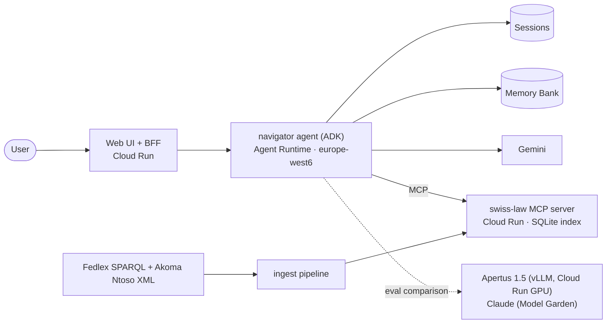

# Swiss Admin Navigator

**Ask everyday questions about Swiss federal law in English, German, French or
Italian, and get answers where every statement cites the exact article on
Fedlex.**

A multilingual, citation-grounded agent built on **Gemini Enterprise Agent
Platform** (ADK, Agent Runtime, Memory Bank), with a public **MCP server**
for Swiss federal law. It is measured by a human-verified eval suite and
benchmarked against the Swiss open model **Apertus**.

> 🚧 **Status: in development.** See [docs/PLAN.md](docs/PLAN.md) for progress.
> Results tables will appear here as milestones land.

> ⚠️ **Unofficial. Not legal advice.** This project is not affiliated with the
> Swiss Confederation or any canton. Law texts come from
> [Fedlex](https://www.fedlex.admin.ch). For decisions, contact the competent
> authority.

---

## What it does

- **Questions about living in Switzerland:** permits, citizenship, employment,
  social insurance, rent, tax at source, licence exchange.
- **Grounded answers:** every legal statement links to the article, with
  verbatim quotes in the authoritative language (DE/FR/IT) and a clearly
  labelled unofficial translation.
- **Honest about scope:** cantonal questions get the federal frame plus a
  pointer to the right office. Out-of-scope requests are declined.
- **Opt-in memory:** it can remember your canton and permit type across
  sessions, shows you what it remembers, and forgets on request.

## Architecture



Details: [docs/ARCHITECTURE.md](docs/ARCHITECTURE.md)

## Why it's built this way

| Choice | Reason |
|---|---|
| Fedlex Akoma Ntoso XML, article-level chunks | Laws are structured. The article is the citation unit. Federal enactments are copyright-free (Art. 5 URG). |
| Dense retrieval with contextual chunk headers + tree navigation | Measured, not assumed: on 102 DE/FR/IT/EN questions, dense recall@8 was 98.5% while BM25 got 51% and BM25+dense fusion *lowered* recall to 85% (ADR-016). BM25 stays as the fallback. The legal hierarchy helps the agent browse. |
| MCP server as the retrieval boundary | Reusable by any MCP client, independently testable and deployable. |
| SQLite baked into the image, not a vector DB | ~30k records don't justify a vector database's cost floor. |
| Single agent first, multi-agent only if evals say so | Complexity has to earn its place. |
| Eval-gated CI | Quote fidelity 100% and zero hallucinated citations are hard gates. |

Decision log: [docs/DECISIONS.md](docs/DECISIONS.md)

## Results

_Coming in M4/M9: golden-set accuracy, citation fidelity, and cost/latency per
model (Gemini, Claude via Model Garden, self-hosted Apertus)._
Methodology: [docs/EVALS.md](docs/EVALS.md)

## Repository layout (target)

```
corpus/        acts.yaml (23 federal acts), SPARQL queries, manifest.lock.json
ingest/        Fedlex → articles.jsonl → index.sqlite
mcp_server/    swiss-law MCP server (mcp SDK 2.x, Streamable HTTP, Cloud Run)
agents/        ADK navigator agent(s), prompts, model profiles
evals/         datasets, harness, reports
web/           Next.js UI + BFF
serving/       Apertus vLLM on Cloud Run GPU
infra/         gcloud setup scripts
docs/          plan, architecture, data, agents, evals, GCP, decisions
```

## Docs

- [PLAN.md](docs/PLAN.md): milestones and acceptance criteria
- [ARCHITECTURE.md](docs/ARCHITECTURE.md): components, flows, answer contract
- [DATA.md](docs/DATA.md): Fedlex pipeline (verified queries and XML structure)
- [AGENTS.md](docs/AGENTS.md): tools, prompts, multi-agent, memory, models
- [EVALS.md](docs/EVALS.md): datasets, metrics, CI gates, experiments
- [GCP.md](docs/GCP.md): setup, deploy recipes, costs
- [DECISIONS.md](docs/DECISIONS.md): ADRs

## License

Code: Apache-2.0. Swiss federal law texts are not subject to copyright
(Art. 5 URG). Source: Fedlex, Swiss Federal Chancellery.
