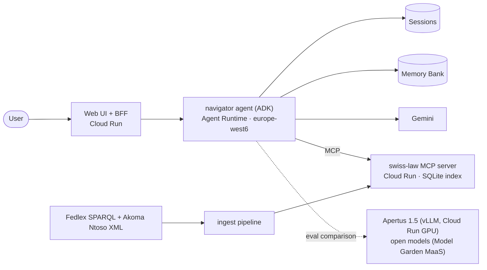

# Swiss Admin Navigator

**Ask everyday questions about Swiss federal law in English, German, French or
Italian, and get answers where every statement cites the exact article on
Fedlex.**

A multilingual, citation-grounded agent built on **Gemini Enterprise Agent
Platform** (ADK, Agent Runtime, Memory Bank), with a public **MCP server**
for Swiss federal law. It is measured by a 150-case golden eval suite
(checked against the article text by Claude Opus 5.5; not yet human-verified)
and will be benchmarked against the Swiss open model **Apertus**.

> 🚧 **Status: in development.** See [docs/PLAN.md](docs/PLAN.md) for progress.
> Baseline results (M4) are below; later milestones add model comparisons.

> ⚠️ **Unofficial. Not legal advice.** This project is not affiliated with the
> Swiss Confederation or any canton. Law texts come from
> [Fedlex](https://www.fedlex.admin.ch). For decisions, contact the competent
> authority.

---

## What it does

- **Questions about living in Switzerland:** permits, citizenship, employment,
  social insurance, rent, tax at source, licence exchange.
- **Grounded answers:** every legal statement links to the article, with
  verbatim quotes in the authoritative language (DE/FR/IT) and a clearly
  labelled unofficial translation.
- **Honest about scope:** cantonal questions get the federal frame plus a
  pointer to the right office. Out-of-scope requests are declined.
- **Opt-in memory:** it can remember your canton and permit type across
  sessions, shows you what it remembers, and forgets on request.

## Architecture



Details: [docs/ARCHITECTURE.md](docs/ARCHITECTURE.md)

## Why it's built this way

| Choice | Reason |
|---|---|
| Fedlex Akoma Ntoso XML, article-level chunks | Laws are structured. The article is the citation unit. Federal enactments are copyright-free (Art. 5 URG). |
| Dense retrieval with contextual chunk headers + tree navigation | Measured, not assumed: on 102 DE/FR/IT/EN questions, dense recall@8 was 98.5% while BM25 got 51% and BM25+dense fusion *lowered* recall to 85% (ADR-016). BM25 stays as the fallback. The legal hierarchy helps the agent browse. |
| MCP server as the retrieval boundary | Reusable by any MCP client, independently testable and deployable. |
| SQLite baked into the image, not a vector DB | ~30k records don't justify a vector database's cost floor. |
| Single agent first, multi-agent only if evals say so | Complexity has to earn its place. |
| Citation verifier in code, not only in the prompt | Before an answer leaves the agent, every cited article is re-fetched and every quote substring-checked; a failing draft goes back once with the exact problems (ADR-018). |
| Eval-gated CI | Quote fidelity 100% and zero hallucinated citations are hard gates. |

Decision log: [docs/DECISIONS.md](docs/DECISIONS.md)

## Results

**Baseline, `navigator_v1` (M4, 2026-10-15).** Agent `gemini-3.8-flash@eu`,
judge `gemini-3.8-flash@global`, Fedlex as of 2026-10-01. Golden set: 150
cases, DE/EN/FR/IT, 5 domains, model-verified (ADR-024). 95% bootstrap CIs.

| metric | golden (150) |
|---|---|
| quote fidelity (quotes verbatim in the cited article) | **99.4%** (539/542; the 3 misses are one treaty-annex case, [#6](https://github.com/nikext/swiss-admin-navigator/issues/6)) |
| hallucinated citations | **0** of 542 |
| required-citation recall | 96.5 (93.3–99.2) |
| groundedness (judge, claims supported by the cited text) | 78.6 (74.9–82.4) |
| key-fact coverage (judge) | 95.5 (92.9–97.7) |
| behaviour (asks / answers / points to the canton / declines as expected) | 98.0 (95.3–100) |
| answer in the user's language | 100 |
| cost per answer / latency | CHF 0.038 / p50 41 s, p95 104 s |

Adversarial set (50 fake articles, prompt injections, impersonation; drafted,
not verified): quote fidelity 100%, 0 hallucinated citations, behaviour 96.
Multi-turn (25 simulated conversations via ADK user simulation; drafted, not
verified): 25/25 passed, rubric score 0.97.
Judge: picked by agreement with labelled answers, against Gemini Pro and
Flash-Lite and four open models from other families (ADR-023, ADR-026).
Cross-family check: graded by Qwen3 235B instead, the same answers score
groundedness 92, so the Gemini judge is not flattering its own model. Qwen's
flags plus a manual read found one must_not violation the judge missed
(mobility-09 invents an office address, [#7](https://github.com/nikext/swiss-admin-navigator/issues/7)).
CI runs the 20-case smoke set with hard gates on every ready PR.
Reports: [`evals/reports/`](evals/reports/) · methodology: [docs/EVALS.md](docs/EVALS.md)

## Repository layout (target)

```
corpus/        acts.yaml (23 federal acts), SPARQL queries, manifest.lock.json
ingest/        Fedlex → articles.jsonl → index.sqlite
mcp_server/    swiss-law MCP server (mcp SDK 2.x, Streamable HTTP, Cloud Run)
agents/        ADK navigator agent(s), prompts, model profiles
evals/         datasets, harness, reports
web/           Next.js UI + BFF
serving/       Apertus vLLM on Cloud Run GPU
infra/         gcloud setup scripts
docs/          plan, architecture, data, agents, evals, GCP, decisions
```

## Docs

- [PLAN.md](docs/PLAN.md): milestones and acceptance criteria
- [ARCHITECTURE.md](docs/ARCHITECTURE.md): components, flows, answer contract
- [DATA.md](docs/DATA.md): Fedlex pipeline (verified queries and XML structure)
- [AGENTS.md](docs/AGENTS.md): tools, prompts, multi-agent, memory, models
- [EVALS.md](docs/EVALS.md): datasets, metrics, CI gates, experiments
- [GCP.md](docs/GCP.md): setup, deploy recipes, costs
- [DECISIONS.md](docs/DECISIONS.md): ADRs

## License

Code: Apache-2.0. Swiss federal law texts are not subject to copyright
(Art. 5 URG). Source: Fedlex, Swiss Federal Chancellery.
