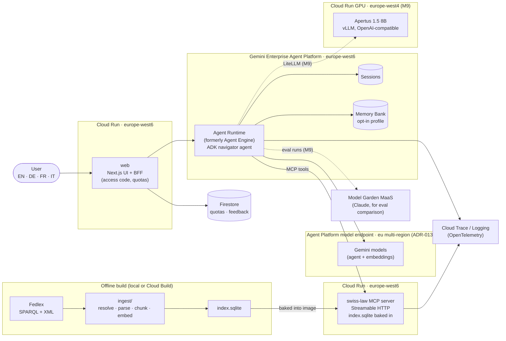
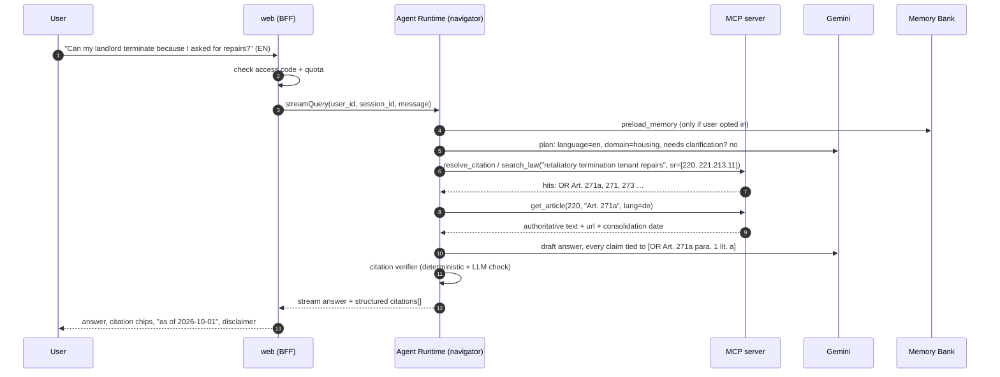

# Architecture

## 1. System overview



## 2. Components

| Component | Dir | Runs on | Responsibility |
|---|---|---|---|
| **ingest** | `ingest/` | local / CI | Resolve acts via SPARQL, download XML, parse Akoma Ntoso, chunk, embed, build `index.sqlite`. Deterministic, cached, reproducible from `manifest.lock.json`. |
| **swiss-law MCP server** | `mcp_server/` | Cloud Run (europe-west6), public, read-only | The retrieval boundary. Tools: `search_law`, `get_article`, `get_toc`, `list_acts`, `resolve_citation`. Any MCP client can use it (Claude Code, Claude Desktop, ADK). The query embedding calls Gemini. Everything else is local SQLite. |
| **navigator agent** | `agents/navigator/` | Agent Runtime (europe-west6) | ADK agent(s). Language detection, clarification, retrieval through MCP tools, grounded answer drafting, citation verification, memory. |
| **web** | `web/` | Cloud Run (europe-west6) | Chat UI with streaming, a citation side panel, a language switcher, the memory opt-in, feedback, and an admin trace link. The BFF holds the service-account credentials and enforces the access code and quotas. |
| **evals** | `evals/` | local / GitHub Actions | Golden sets, ADK evalsets, custom metrics (citation precision/recall, groundedness), model comparison runner, reports. |
| **apertus serving** | `serving/apertus/` | Cloud Run GPU (europe-west4) | Self-hosted Swiss open model for the sovereignty comparison (M9). Scales to zero. |
| **infra** | `infra/` | — | Idempotent `gcloud` setup scripts, IAM, budget alerts, Artifact Registry. Terraform is a stretch goal. |

## 3. Request flow (single question)



## 4. Answer contract

The agent's final output is **structured**. The UI renders it, and evals score
it field by field.

```json
{
  "language": "en",
  "answer_markdown": "Yes, a termination can be challenged if … [1]",
  "citations": [
    {
      "ref": "1",
      "sr": "220", "abbr": "OR", "article": "Art. 271a", "paragraph": "1", "letter": "a",
      "quote_lang": "de",
      "quote": "Die Kündigung durch den Vermieter ist insbesondere anfechtbar, wenn sie ausgesprochen wird: a. weil der Mieter …",
      "translation": "A termination by the landlord may in particular be challenged if … (unofficial translation)",
      "url": "https://www.fedlex.admin.ch/eli/cc/27/317_321_377/de#art_271_a",
      "as_of": "2026-10-01"
    }
  ],
  "cantonal_note": "Deadlines to file with the conciliation authority are federal (OR Art. 273), but the competent office is cantonal: …",
  "follow_up_questions": ["…"],
  "confidence": "high | medium | low",
  "out_of_scope": false
}
```

Rules (enforced by the prompt, the verifier, and evals):

1. **No claim without a citation.** Every legal statement maps to at least one
   `citations[]` entry that `get_article` confirmed exists.
2. **Quotes are verbatim** from the stored article text. The verifier checks
   them by substring match after whitespace normalisation.
3. **The original language is authoritative.** A translation is labelled
   "unofficial translation".
4. **Cantonal and communal questions** get the federal frame plus a pointer to
   the cantonal authority. No invented cantonal rules.
5. **Out of scope** (criminal defence, ongoing proceedings, individual tax
   computation, anything needing a lawyer): say so and point to official help.
   No speculative advice.

## 5. Regions and residency

- Agent Runtime, Sessions, Memory Bank, Sandboxes and Agent Gateway are all
  supported in **europe-west6 (Zürich)** (verified on the Agent Platform
  locations page, 2026-10-15).
- **Gemini is not served in Zürich** for this project (live-checked
  2026-10-15, ADR-013). `gemini-3.8-flash`, `gemini-embedding-2` and the
  alternatives return 404 in europe-west6 and in every single EU region we
  tried. They are served on the **`eu` multi-region endpoint** (ML processing
  within EU member states; Switzerland is explicitly excluded) and on
  `global`. Agent and embedding calls use `eu`. The eval judge
  (`gemini-3.1-pro-preview`) is only on `global`, which is fine because it
  only sees eval data. Locations live in the model profile, not in
  `GOOGLE_CLOUD_LOCATION`.
- In the README say "agent deployed in europe-west6 (Zürich), model calls
  processed in the EU". Don't say "runs in Zürich" or "data never leaves
  Switzerland".
- **Cloud Run GPUs are not offered in europe-west6.** L4 runs in
  europe-west1/europe-west4/us-central1, and RTX PRO 6000 (preview) in
  europe-west4 among others. Apertus therefore runs in **europe-west4**. Say so
  honestly in the comparison write-up.

## 6. Why these boundaries

- **MCP server as the retrieval boundary.** It decouples retrieval from the
  agent framework, makes the corpus reusable by any MCP client (a nice
  standalone artifact: "plug Swiss federal law into Claude"), and is
  independently testable and deployable. See DECISIONS.md ADR-003.
- **Index baked into the image** (the same pattern as `nikext/zuri-sunny`). No
  vector-DB cost floor, cold start stays fast with a ~150 MB image, and builds
  are reproducible. See ADR-002.
- **Agent Runtime instead of a self-hosted ADK API server.** It gives managed
  Sessions, Memory Bank, tracing and scaling, and puts "Gemini Enterprise
  Agent Platform" on the CV. See ADR-004.
